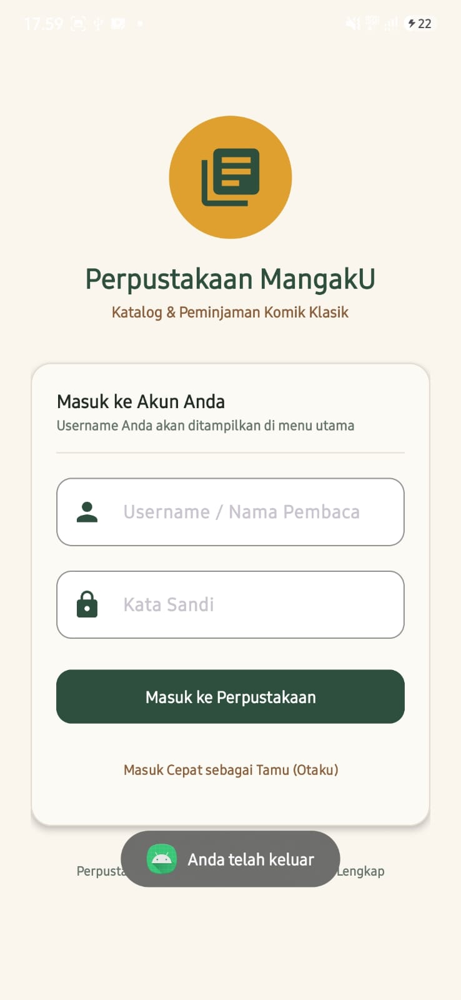
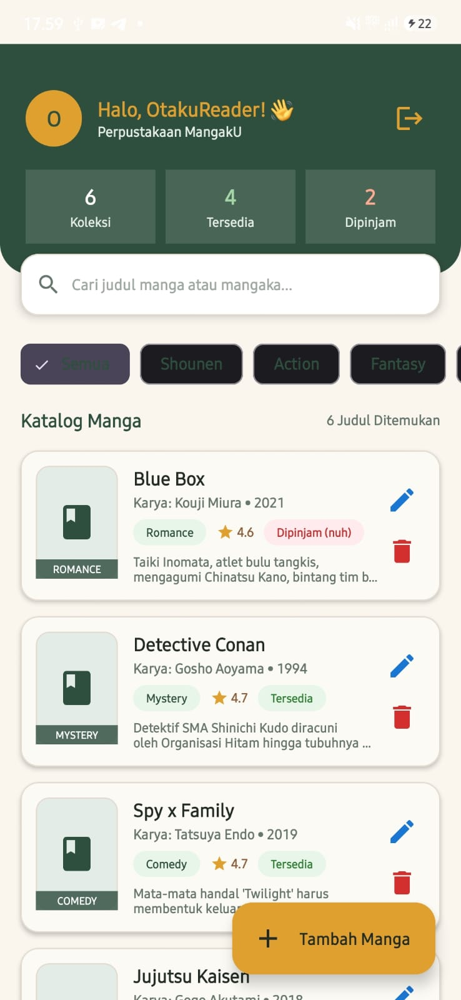

# 📚 MangakU - Aplikasi Perpustakaan Manga

**MangakU** adalah aplikasi Android berbasis Kotlin bertema perpustakaan klasik dan modern yang memungkinkan pengguna untuk mengelola katalog komik/manga, membaca informasi detail, melakukan peminjaman buku, serta mengelola data secara penuh melalui fitur **CRUD (Create, Read, Update, Delete)**.

---

## 📸 Tangkapan Layar Aplikasi (Screenshots)

<div align="center">
  <table>
    <tr>
      <td align="center"><b>Halaman Login</b></td>
      <td align="center"><b>Menu Utama &amp; Katalog Manga</b></td>
    </tr>
    <tr>
      <td align="center">
        
      </td>
      <td align="center">
        
      </td>
    </tr>
  </table>
</div>

---

## ✨ Fitur Utama

### 1. 🔐 Autentikasi & Sesi Pengguna
- **Tampilan Login Elegan:** Desain bertema perpustakaan klasik dengan validasi input username dan kata sandi.
- **Masuk Cepat (Guest):** Opsi masuk langsung sebagai tamu (*OtakuReader*) tanpa perlu mengisi form manual.
- **Username Tampil di Menu Utama:** Setelah login, sapaan personal `Halo, [Username]! 👋` beserta inisial avatar langsung ditampilkan di bar menu bagian atas.
- **Sesi Pengguna:** Status login tersimpan di `SharedPreferences` (`SessionManager`).
- **Keluar Akun (Logout):** Tombol keluar dengan dialog konfirmasi untuk berganti akun.

### 2. 🗂️ Menu & Navigasi Perpustakaan
- **Statistik Katalog Dinamis:** Ringkasan jumlah **Total Koleksi**, **Tersedia**, dan **Sedang Dipinjam**.
- **Pencarian Real-Time:** Pencarian judul manga atau nama mangaka secara instan dengan tombol pembersih pencarian.
- **Filter Kategori (Chips):** Filter cepat berdasarkan genre (*Semua, Shounen, Action, Fantasy, Romance, Mystery, Comedy*).

### 3. ⚡ Operasi CRUD & Manajemen Koleksi
- **Create (Tambah Manga):** Tombol Floating Action Button (FAB) `+ Tambah Manga` membuka formulir dialog untuk menginput Judul, Mangaka, Genre, Tahun Rilis, Rating, Status, dan Sinopsis.
- **Read (Katalog & Detail):**
  - Kartu bergaya kartu katalog arsip perpustakaan lengkap dengan cover, rating bintang, genre badge, dan status ketersediaan (*Tersedia / Dipinjam*).
  - Klik kartu untuk membuka pop-up detail lengkap sinopsis dan aksi peminjaman/pengembalian buku atas nama pengguna yang sedang login.
- **Update (Edit Manga):** Tombol ikon pensil pada setiap kartu untuk memperbarui informasi manga kapan saja.
- **Delete (Hapus Manga):** Tombol ikon tempat sampah dengan dialog konfirmasi keamanan agar data tidak sengaja terhapus.

---

## 🎨 Palet Desain & Tema Perpustakaan

Desain visual aplikasi mengadopsi estetika perpustakaan klasik yang hangat dan nyaman:
- **Krem Lembut (`#FAF6EE`):** Latar belakang utama aplikasi yang ramah di mata.
- **Hijau Perpustakaan Tua (`#2F4F3E`):** Warna utama pada header melengkung, tombol, dan kartu identitas.
- **Aksen Emas (`#E0A030`):** Aksen pada avatar, tombol tambah FAB, dan bintang rating.
- **Cokelat Kayu (`#8B5E3C`):** Aksen sekunder bernuansa rak buku kayu klasik.
- **Kartu Arsip (`#FCFAF4` / `#E3DBCF`):** Border dan background kartu menyerupai katalog arsip perpustakaan.

---

## 🛠️ Teknologi & Arsitektur

- **Bahasa:** Kotlin
- **Antarmuka (UI):** XML Layouts dengan Material Components 3 (MaterialCardView, ExtendedFloatingActionButton, ChipGroup, TextInputLayout)
- **View Binding:** Menghubungkan layout XML secara aman dan efisien
- **Penyimpanan Data:** Database lokal SQLite (`SQLiteOpenHelper`) dengan seeded data manga populer (*One Piece, Frieren, Jujutsu Kaisen, Spy x Family, Detective Conan, Blue Box*)
- **Target SDK:** Android 14+ (API Level 34 - 37)

---

## 📁 Struktur Direktori Penting

```text
app/src/main/
├── AndroidManifest.xml
├── java/com/example/mangaku/
│   ├── LoginActivity.kt              # Aktivitas login pengguna
│   ├── MainActivity.kt               # Menu utama, tampilan username, & CRUD
│   ├── data/
│   │   ├── model/Manga.kt            # Data model manga
│   │   └── db/MangaDatabaseHelper.kt # SQLite Helper untuk CRUD
│   ├── ui/
│   │   └── adapter/MangaAdapter.kt   # Adapter RecyclerView kartu manga
│   └── util/
│       └── SessionManager.kt         # Manajemen sesi login (SharedPreferences)
└── res/
    ├── drawable/                     # Vektor icon & background kustom
    ├── layout/
    │   ├── activity_login.xml        # Layout layar login
    │   ├── activity_main.xml         # Layout menu utama & header
    │   ├── item_manga.xml            # Layout kartu katalog manga
    │   ├── dialog_manga_form.xml     # Dialog form tambah/edit manga
    │   └── dialog_manga_detail.xml   # Dialog detail & peminjaman komik
    └── values/
        ├── colors.xml                # Definisi palet warna perpustakaan
        └── themes.xml                # Tema Material3 NoActionBar
```

---

## 🚀 Cara Menjalankan Proyek

1. Buka folder proyek di **Android Studio**.
2. Tunggu proses **Gradle Sync** selesai.
3. Hubungkan perangkat fisik Android atau gunakan **Android Virtual Device (AVD / Emulator)**.
4. Klik tombol **Run ('app')** atau tekan `Shift + F10`.
5. Masuk dengan nama/username Anda untuk melihat nama Anda langsung tampil di menu utama!
